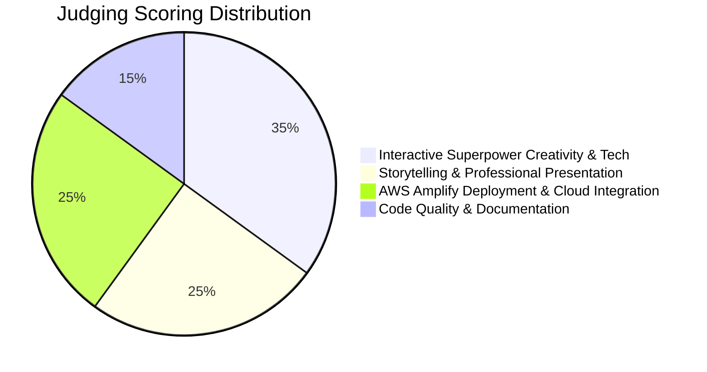

# 01 — Challenge Overview: AWS Student Builder Challenge

> **AWS Builder Center Hackathon Reference Sheet**

---

## 1. Challenge Details & Metadata

| Attribute | Details |
| :--- | :--- |
| **Official Title** | AWS Student Builder Challenge: Build Your Tech Superpower |
| **Host** | AWS Builder Center |
| **Status** | Live |
| **Start Date** | October 27, 2026 |
| **End Date / Deadline** | November 6, 2026 (11:59 PM PST) |
| **Duration** | ~11 Days |
| **Participation Format** | Individual Challenge (Teams are not permitted) |
| **Target Audience** | Verified students enrolled in higher education institutions |
| **Hosting Requirement** | **Must be hosted live on AWS Amplify Hosting** |

---

## 2. Core Prompt & Problem Statement

> *"Build and deploy your personal portfolio website on AWS. It should tell your story, show your skills and projects, and feature a working, creative interactive superpower."*

Most student portfolios are static, cookie-cutter templates that fail to stand out to recruiters and engineering leads. This challenge asks students to build a personal brand platform hosted on the AWS cloud that demonstrates tangible technical competence through an inventive, working interactive feature.

---

## 3. Mandatory Deliverables

1. **Live Hosted Portfolio on AWS Amplify**:
   - A publicly accessible URL hosted on AWS Amplify Hosting (`https://main.<id>.amplifyapp.com` or custom domain via Route 53).
   - Fast load times, responsive on both desktop and mobile viewports.
2. **Personal Narrative & Skill Showcase**:
   - Compelling personal story: background, passions, engineering trajectory.
   - Project deep dives: problem statement, technologies, architectures, and links to live demos/code.
   - Technical skills matrix and certifications (AWS badges, cloud skills, programming languages).
3. **The Working "Interactive Superpower"**:
   - A distinctive, fully functional interactive feature built directly into the site.
   - Examples: An embedded AI assistant answering technical interview questions, an interactive terminal console, a cloud architecture puzzle, a live code playground, or an interactive data visualization.
4. **Public Code Repository**:
   - Clean, well-structured GitHub/GitLab repository with open-source license.
   - A comprehensive `README.md` explaining the AWS architecture, how the site was built, and how to run it locally.

---

## 4. Prizes & Recognition

- **Grand Prize / Category Winners:**
  - AWS Promotional Credits (\$500 – \$1,000) for personal cloud projects.
  - Official AWS Foundational & Associate Certification Exam Vouchers (e.g. AWS Cloud Practitioner, Solutions Architect Associate).
  - Official AWS Builder Swag Kit (backpack, hoodie, developer pins).
  - Feature on the official AWS Builder Center student spotlight and social channels.

---

## 5. Evaluation Criteria & Scoring Rubric

Judges evaluate submissions across 4 pillars:

1. **Interactive Superpower (35%)**:
   - Is the feature genuinely interactive, creative, and functional?
   - Does it showcase advanced technical ability beyond simple static HTML/CSS?
2. **Storytelling & Professional Presentation (25%)**:
   - Does the portfolio tell a memorable personal narrative?
   - Is the visual hierarchy, typography, and UI polished, accessible, and responsive?
3. **AWS Amplify Deployment & Cloud Integration (25%)**:
   - Flawless live deployment on AWS Amplify Hosting with continuous deployment configured.
   - Effective integration with AWS backend services (e.g., Bedrock, DynamoDB, Lambda, API Gateway).
4. **Code Quality & Documentation (15%)**:
   - Clean, modular code (TypeScript/React/Vue/Svelte).
   - Clear setup documentation and architecture diagram in the README.

