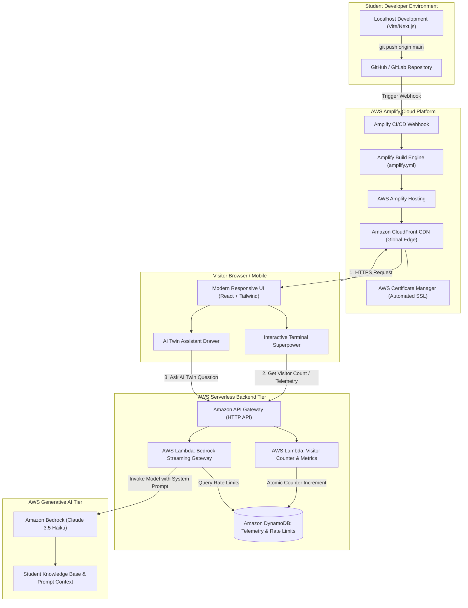

# 03 — System Architecture: AWS Student Builder Challenge

This document provides the full cloud architecture for the portfolio website, covering frontend delivery, automated CI/CD pipeline, serverless backend microservices, and AI model integration on AWS.

---

## 🏛️ End-to-End System Architecture Diagram

---

## 🔍 Architecture Component Deep Dive

### 1. Edge & Hosting Tier (AWS Amplify Hosting)
- **Git-Integrated Continuous Deployment:** Every `git push` to `main` automatically triggers a zero-downtime build and deployment on Amplify.
- **Global Edge Caching:** Assets (HTML, JS, CSS, images, WebP icons) are distributed across Amazon CloudFront's global network of 400+ points of presence.
- **Custom Domain & SSL:** Automated SSL certificate provisioning via AWS Certificate Manager (ACM) with free renewal and HSTS encryption.
- **Preview Environments:** Pull requests can generate instant preview branch URLs (`https://pr-2.<id>.amplifyapp.com`) for testing before merging.

### 2. Frontend Client Architecture
- **Framework:** React 18 with Vite or Next.js 14 (Static Site Generation / Export mode).
- **Styling:** Tailwind CSS with a calibrated dark-mode palette (`slate-950` background, `emerald-400` / `cyan-400` accents).
- **Animations:** Lucide React icons + Framer Motion for smooth micro-interactions.
- **State Management:** Lightweight React Hooks (`useState`, `useReducer`) managing terminal command history and chat messages.

### 3. Serverless Backend Tier (Visitor Counter & Contact Hub)
- **Amazon API Gateway (HTTP API):** Low-latency, cost-effective API endpoint with built-in CORS configuration.
- **AWS Lambda (`VisitorCounterFunction`):** Node.js 20 or Python 3.12 runtime. Performs an atomic `UpdateItem` on DynamoDB to increment the visitor counter and log country/browser metadata without race conditions.
- **Amazon DynamoDB (`PortfolioTable`):** Single-table design with on-demand capacity mode:
  - `PK: "METRICS"`, `SK: "VISITORS"`, `count: 1420`
  - `PK: "MESSAGE#<timestamp>"`, `SK: "<email>"`, `content: "..."`

### 4. Generative AI Superpower Tier (Amazon Bedrock)
- **Model:** Anthropic Claude 3.5 Haiku via Amazon Bedrock. (Blazing fast ~300ms latency, fraction of a cent per query).
- **Prompt Isolation:** System instructions strictly restrict answers to your professional portfolio context, preventing prompt injections or off-topic hallucinations.
- **Rate-Limiting:** IP-hashed DynamoDB records enforce a cap of 10 requests per user per hour to prevent accidental API credit exhaustion.

