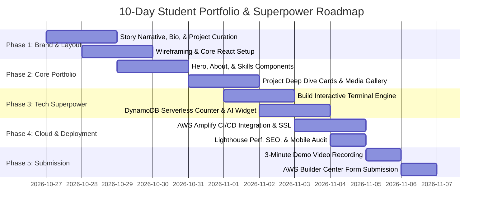

# 05 — Implementation Roadmap: AWS Student Builder Challenge

> **10-Day Structured Sprint Schedule (October 27 – November 6)**

---

## ⏱️ Timeline Milestones At A Glance

---

## 📅 Day-by-Day Implementation Breakdown

### Days 1–2 (Oct 27–28): Narrative Architecture & Foundation
- **Goal:** Clear personal narrative, curated list of 3-4 top projects, and modern React/Vite project initialized.
- **Tasks:**
  1. Draft your personal story:
     - The Hook: What sparks your obsession with software and cloud?
     - The Journey: Courses, hackathons, open-source commits, community leadership.
     - The Goal: The engineering domain you want to master (Cloud Architect, Systems Engineer, ML/AI Developer).
  2. Curate 3 flagship projects with:
     - Problem statement, architectural solution, technologies used, GitHub link, live demo URL, and metrics (e.g. "Reduced API latency by 45%").
  3. Initialize Git repo with React + TypeScript + Tailwind CSS:
     - `npm create vite@latest portfolio -- --template react-ts`
     - Install `lucide-react`, `canvas-confetti`, `clsx`, `tailwind-merge`.

### Days 3–4 (Oct 29–30): Core Portfolio UI & Responsiveness
- **Goal:** Polished, responsive homepage with Hero, About Me, Skills Radar, and Projects Grid.
- **Tasks:**
  1. Build **Hero Section**:
     - Striking headline, sub-headline, avatar/photo, status badge (*"Open to Summer 2027 Internships"*), and primary CTAs (*"Launch Terminal"* / *"View Projects"*).
  2. Build **Interactive Skills Matrix**:
     - Categorized by Cloud/AWS, Languages, Databases, DevOps, Tools.
  3. Build **Projects Section**:
     - Clean responsive cards with image previews, tech badges, GitHub buttons, and live demo links.
  4. Build **Resume & Education Timeline**:
     - Visual vertical timeline of degree milestones, coursework, and AWS certifications.

### Days 5–6 (Oct 31 – Nov 1): The Interactive Superpower (Terminal Engine)
- **Goal:** Fully functional interactive CLI terminal integrated into the portfolio.
- **Tasks:**
  1. Create `Terminal.tsx` component with:
     - Shell prompt (`visitor@student-portfolio:~$ `).
     - Command parser supporting `help`, `bio`, `skills`, `projects`, `contact`, `clear`, `sudo hire`, `matrix`.
     - Tab completion and command history navigation via Up/Down arrow keys.
  2. Add sound effects (optional subtle mechanical keystroke sounds) or visual scanlines toggle.
  3. Implement responsive drawer or split-screen mode:
     - On desktop, terminal can open in a floating draggable window or modal.
     - On mobile, full-width responsive terminal tab.

### Days 7–8 (Nov 2–3): AWS Serverless Backend & Amplify CI/CD
- **Goal:** Portfolio deployed live on AWS Amplify Hosting with working serverless telemetry.
- **Tasks:**
  1. Deploy Lambda function and API Gateway for the Visitor Counter (incrementing DynamoDB atomically).
  2. Embed real-time visitor counter badge on the portfolio footer: *"Visits logged on AWS: 1,420"*.
  3. Push repository to GitHub.
  4. In AWS Management Console, connect repo to **AWS Amplify Hosting**:
     - Verify automatic build and deployment pipeline.
     - Test live Amplify URL (`https://main.<id>.amplifyapp.com`).
     - Test single-page app rewrite rule to prevent 404s on refresh.

### Day 9 (Nov 4): Quality Assurance, Accessibility & Performance
- **Goal:** 95+ score on Google Lighthouse and complete cross-device verification.
- **Tasks:**
  1. Run Chrome Lighthouse audit:
     - Ensure Performance, Accessibility, Best Practices, and SEO are all in the green (90+).
  2. Add OpenGraph meta tags, favicon, and dynamic preview image for Twitter/LinkedIn shares.
  3. Verify color contrast ratios for accessibility (WCAG AA).
  4. Test on Safari (iOS), Chrome (Android), and various desktop screen resolutions.

### Day 10 (Nov 5–6): Video Walkthrough & AWS Builder Center Submission
- **Goal:** Polished 3-minute video pitch and verified submission on AWS Builder Center.
- **Tasks:**
  1. Record 3-minute screen walkthrough using OBS Studio or Loom following [`06_SUBMISSION_AND_DEMO_GUIDE.md`](./06_SUBMISSION_AND_DEMO_GUIDE.md).
  2. Upload demo video to YouTube (unlisted) or Loom.
  3. Write comprehensive GitHub `README.md` with architecture diagrams and local dev steps.
  4. Complete and submit the project on the AWS Builder Center before November 6, 2026.

